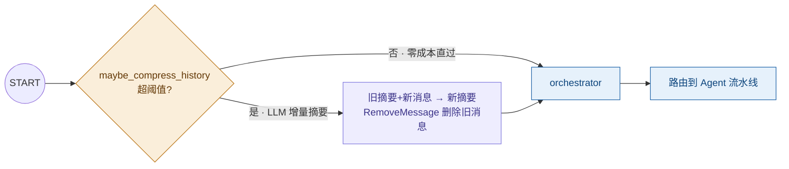

# 长对话上下文治理：摘要压缩方案

> 解决问题：LangGraph 每个节点执行后 Checkpointer **全量快照 State**，`messages` 按 `add_messages` 语义只增不减——长对话下 checkpoint 体积与 LLM prompt 线性膨胀，最终撞上下文窗口、成本失控。
> 实现：`app/graph/summarize.py`（`maybe_compress_history` 节点）+ State 字段 `conversation_summary`。
> 测试：`python tests/test_compression.py`（6 项断言）。

## 1. 方案设计（输入输出与评估）

| 项 | 定义 |
|---|---|
| **输入** | `state.messages`（对话历史）+ `state.conversation_summary`（旧摘要） |
| **输出** | 更新后的 `conversation_summary` + `RemoveMessage` 列表（删除被压缩的消息） |
| **触发条件** | 消息条数 > 20 **或** 估算 token > 4000（任一满足） |
| **保留策略** | 最近 6 条原文（约 3 轮），其余压缩 |
| **压缩方式** | **增量摘要**：旧摘要 + 新增消息一起喂 LLM，生成融合后的新摘要（不重复全文压缩） |
| **评估指标** | 压缩率（实测 26 条/536 tokens → 摘要+6 条/约 236 tokens，**降 56%**）；信息保持度（prompt 强制保留需求/标的/结论/未决问题）；延迟增量（一次摘要调用约 2-4s，仅超阈值时发生） |

## 2. 三个关键实现决策

**① 摘要存独立字段，不混入 messages**
`conversation_summary` 是 State 的独立 `str` 字段。若把摘要做成一条消息插入 messages，会被 `add_messages` 当成普通历史反复传递、难以区分——独立字段让「摘要」和「原文」边界清晰，也便于按需剔除。

**② 删除消息必须用 `RemoveMessage`（常见坑）**
`Annotated[list, add_messages]` 的 reducer 按消息 id **合并**：返回的 list 里没有的旧消息**不会被删除**。直接返回裁剪后的 list 是无效操作——必须显式返回 `[RemoveMessage(id=m.id) for m in to_compress]`。

**③ 兜底：宁可 prompt 长，不可丢历史**
LLM 不可达或摘要失败时**不压缩**（保留原样 + 警告日志）。丢消息是不可逆的信息损失，prompt 长只是成本问题——降级方向明确。

## 3. 链路中的位置



任何需要读对话历史的代码，用 `build_chat_context(state)` 组装上下文（`[摘要 SystemMessage] + 最近 N 条原文`），不要直接读 `state["messages"]`。

## 4. 控制台报告：压缩过程可视化

`maybe_compress_history` 真正执行压缩时，会向 stdout 打印一份**数据变化报告**（`print_compression_report`），阈值内零输出不打扰。实测样例（`python tests/test_compression.py`）：

```
━━━━━━━━━━━━━━━━━━━━━━━━━━━━━━━━━━━━━━━━━━━━━━━━━━━━━━━━━━━━━━━━━━
  对话摘要压缩报告（触发条件：26 条 > 20 条阈值）
━━━━━━━━━━━━━━━━━━━━━━━━━━━━━━━━━━━━━━━━━━━━━━━━━━━━━━━━━━━━━━━━━━

[压缩前] 26 条消息 · 估算 536 tokens
  旧摘要：用户此前分析过比亚迪，评级增持。
  消息列表：
  ├─ [用户] 第0轮：帮我分析宁德时代第0号问题
  ├─ [助手] 第0轮答复：估值360元，评级买入（编号1）
  │    … 中间 18 条折叠 …
  └─ [助手] 第12轮答复：估值360元，评级买入（编号25）

[压缩动作]
  · LLM 增量摘要：旧摘要 + 20 条消息 → 新摘要（qwen3.5:9b）
  · RemoveMessage 删除 20 条（add_messages 按 id 合并，必须显式删除）
  · 保留最近 6 条原文进 prompt

[压缩后] 6 条消息 + 摘要 101 字 · 估算 323 tokens
  新摘要：用户此前对比亚迪给予增持评级。本次连续多轮聚焦宁德时代分析，
  结论一致：目标价均为 360 元，评级维持买入……

[效果]
  token      536 → 323    ↓ 39.7%
  条数         26 → 6      ↓ 76.9%
```

报告包含五个区块：**压缩前**（条数/token/旧摘要/消息列表，超 8 条折叠中间）、**压缩动作**（删了几条、留了几条、走的哪个模型）、**压缩后**（新摘要全文）、**效果**（token 与条数双指标降幅）。兜底不压缩时打印简短的 `[压缩跳过] … 原因`。

两个细节：
- 消息预览的中文对齐用 `unicodedata.east_asian_width` 计算显示宽度（全角字符占 2 列），避免框线错位
- 日志双轨：`print` 报告块给人看（直观），`logger.info/warning` 单行给运维检索（`grep fundagent.summarize`）

## 5. 阈值调参

`app/graph/summarize.py` 顶部三个常量：

| 常量 | 默认 | 调整建议 |
|---|---|---|
| `MAX_MESSAGES` | 20 | 多轮密集型业务（追问频繁）调到 30-40，减少压缩频次 |
| `MAX_TOKENS` | 4000 | 模型上下文 1/8 以下留足生成空间；换大窗口模型可提高 |
| `KEEP_RECENT` | 6 | 保证至少 3 轮原文在 prompt 里，维持指代消解（"它""这家"）的准确性 |

## 6. 幻觉控制与成本

- **幻觉**：system prompt 强制「只基于给定内容提炼，不得推断补充」+ 「必须保留需求/标的/结论/未决问题」+ temperature 0.1。摘要是压缩不是创作，约束写死
- **成本**：增量摘要使每次压缩只处理「上次摘要之后的新消息」，token 成本与总轮数**亚线性**；阈值内零调用。若日任务 3 万且 10% 触发压缩，日均增加约 3000 次摘要调用（qwen3.5:9b 本地推理零现金成本，云端部署需计入）
- **延迟**：压缩节点串行在主链上，仅超阈值时 +2-4s；可接受（命中率低）

## 7. 局限与后续

- **摘要有损**：极端情况下细节丢失，故保留 6 条原文 + 兜底不压缩；高要求的审计场景应直接查长期记忆（`analysis_results` 表）而非依赖摘要
- **当前触发面有限**：demo 模式「新任务新 thread」，messages 通常只有 1 条，压缩不会触发——本方案是为多轮追问场景预置的基础设施（`POST /api/chat` 传 `thread_id` 续跑时生效）
- **未做**：跨 thread 的历史检索（那属于长期记忆 + RAG 范畴，不该由 Checkpointer 承担）
