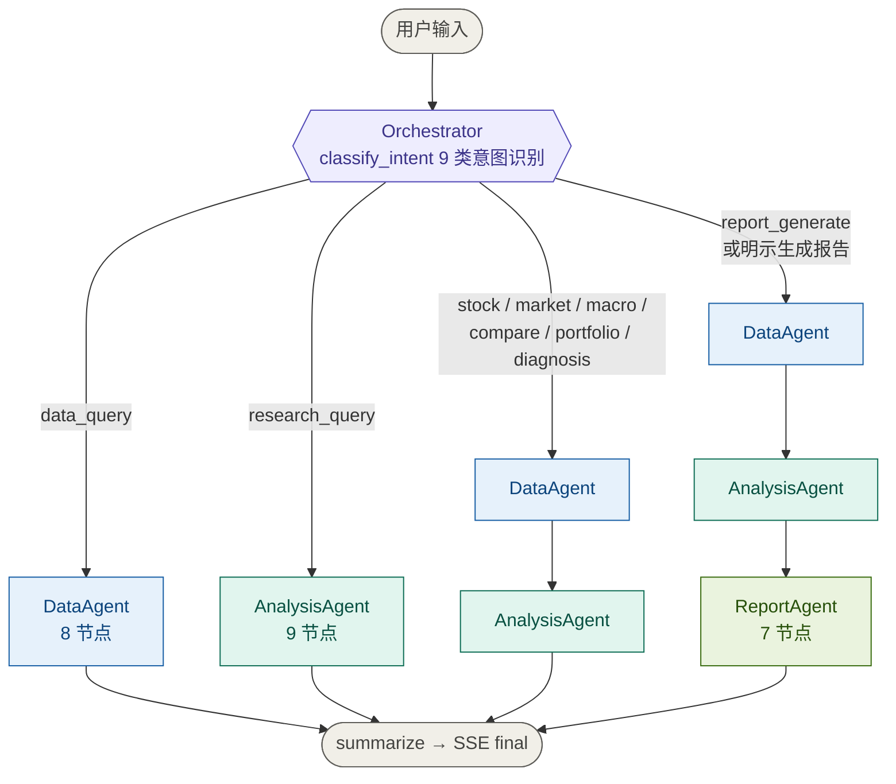
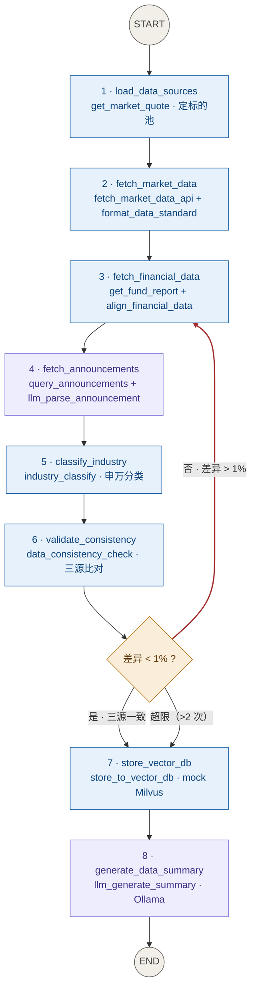
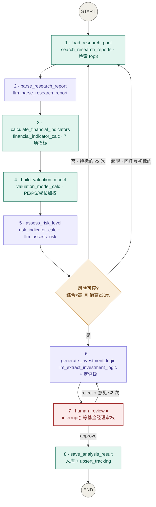
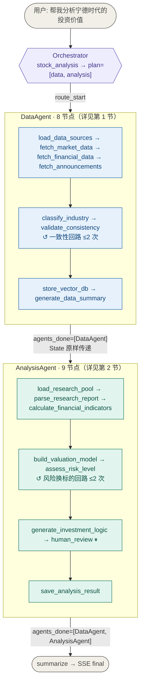
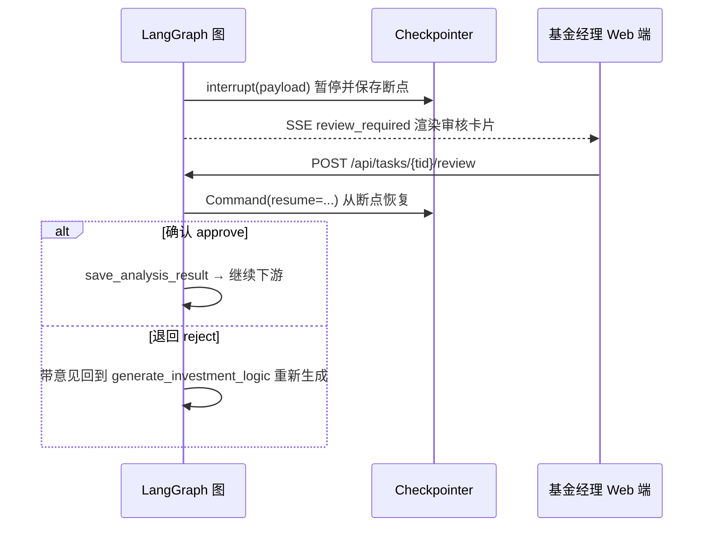
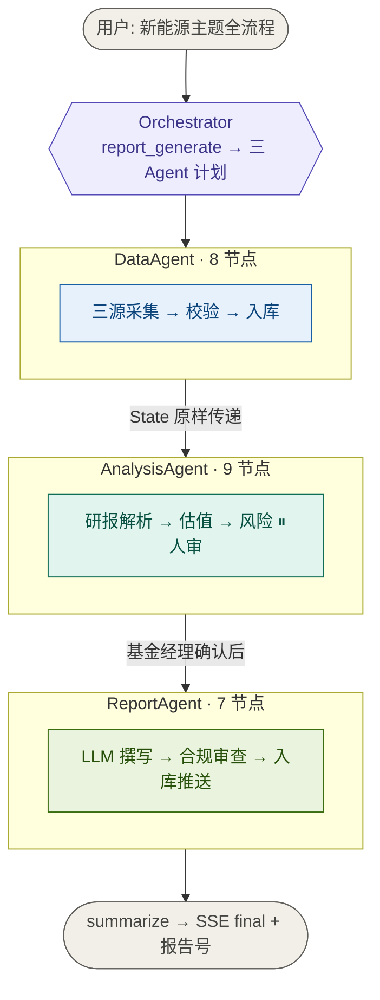

# FundAgent AI · 九类意图完整链路文档

> 对应文档：《AgenticWorkflow-EduAgent 项目场景拓展文档》1.13 节意图分类详表（8 类）+ 本实现补充的 `report_generate`（第 9 类，显式要求出报告时触发）。
> 代码基线：`app/graph/orchestrator.py`（意图识别与顶层图）、`app/graph/{data,analysis,report}_agent.py`（三个子图）。

## 图的配色约定

| 颜色 | 含义 |
|---|---|
| 灰色圆角 `(( ))` | 流程起点 / 终点 |
| 蓝色框 | DataAgent 节点（数据/规则/MCP） |
| 靛色框 | Orchestrator 编排决策 |
| 青色框 | AnalysisAgent 节点 |
| 绿色框 | ReportAgent 节点 |
| 紫色框 | LLM 节点（Ollama qwen3.5:9b） |
| 琥珀菱形 `{ }` | 条件边判断 |
| 红色虚线边 `-.->` | 重试 / 回流回路 |
| 红色粗体节点 | Human-in-the-Loop 人工审核 |

---

## 0. 总览：九类意图路由



| # | 意图 | 典型问法 | 路由 | LLM 调用* |
|---|---|---|---|---|
| 1 | `data_query` | 查一下贵州茅台最新的财务数据 | DataAgent | 2 + N |
| 2 | `research_query` | 帮我找关于比亚迪的研报 | AnalysisAgent | 4 |
| 3 | `stock_analysis` | 帮我分析宁德时代的投资价值 | DataAgent → AnalysisAgent | 6 + N |
| 4 | `market_analysis` | 新能源主题走势怎么样 | DataAgent → AnalysisAgent | 6 + N |
| 5 | `macro_analysis` | 最新 CPI 对债市的影响 | DataAgent → AnalysisAgent | 6 + N |
| 6 | `industry_compare` | 对比宁德时代和比亚迪 | DataAgent → AnalysisAgent | 6 + N |
| 7 | `portfolio_advice` | 帮我优化这个持仓组合 | DataAgent → AnalysisAgent | 6 + N |
| 8 | `financial_diagnosis` | 诊断一下恒大财务状况 | DataAgent → AnalysisAgent | 6 + N |
| 9 | `report_generate` | …从数据采集到生成基金报告全流程 | DataAgent → AnalysisAgent → ReportAgent | 7 + N |

\* N = 标的池大小（公告逐只解析）；`llm_generate_report` 约 17s/1379 字，其余 1.6-2.6s。

**路由决策代码**（`orchestrator.py`）：

```python
def build_plan(intent, query):
    wants_report = ("全流程" in query or "从数据采集" in query
                    or (("生成" in query or "撰写" in query or "写" in query) and "报告" in query))
    if intent == "data_query":            plan = ["data_agent"]
    elif intent == "research_query":      plan = ["analysis_agent"]
    elif intent == "report_generate":     plan = ["data_agent", "analysis_agent", "report_agent"]
    else:                                 plan = ["data_agent", "analysis_agent"]
    if wants_report and "report_agent" not in plan:
        plan.append("report_agent")
    return plan
```

顶层图跳转由 `_next_in_plan` 驱动的三个条件边完成：每个 Agent 完成后写入 `agents_done`，条件边按 `plan` 顺序找下一个未执行的 Agent，找不到就进 `summarize`。

---

## 1. data_query —— 数据查询（唯一单 Agent 直达）

**识别**：关键词 `查一下 / 查下 / 财务数据 / 公告 / 最新数据`。

**走法**：总览图最左分支 —— `orchestrator → DataAgent → summarize → SSE final`。核心在 DataAgent 内部：



**读图要点**：
- 红色边（第 9 条边）是唯一的重试回路：mock 数据里公告 EPS 有 1.2% 偏差，每次演示都会真实触发一次（不通过 → 回第 3 节点切公告口径 → 二次通过）
- 紫色节点 = LLM 调用（公告逐只并行 + 摘要），其余 6 个节点零 token 成本
- 产出只有 `data_summary`，无估值/评级/报告——这是它与其他意图的本质区别

---

## 2. research_query —— 研报检索（直达 AnalysisAgent）

**识别**：关键词 `研报 / 报告查询 / 找一下 / 深度报告 / 检索`。

**走法**：总览图第二分支 —— `orchestrator → AnalysisAgent → summarize`。不经 DataAgent，财务数据在 `load_research_pool` 内按需补齐。



**读图要点**：
- 两个回路都在图上：风险换标的（红标签虚线语义，`load_research_pool` 处旋转研报池）和审核退回（`human_review` → `generate_investment_logic`）
- 换标的的连贯性由 `_base_primary`（排序）/ `_primary_code`（分析，重试旋转+超限回迁）/ `_pool_index`（研报下标）三函数协同，保证估值/财务/逻辑始终锁定同一标的
- 与 stock_analysis 的区别只是没有前面的 DataAgent——第 1 节点会补齐财务数据

---

## 3-8. 六类复杂意图（DataAgent → AnalysisAgent，链路完全相同）

`stock_analysis` / `market_analysis` / `macro_analysis` / `industry_compare` / `portfolio_advice` / `financial_diagnosis` 共享一条链路，差异只在触发词与标的池来源：

| 意图 | 触发词 | 标的池来源 |
|---|---|---|
| `stock_analysis` | 投资价值 / 值不值得 / 深度分析 / 分析一下 | query 点名个股 |
| `market_analysis` | 走势 / 行情怎么样 / 主题 / 板块 / 速览 | 主题关键词（如"新能源"5 只） |
| `macro_analysis` | 宏观 / CPI / M2 / GDP / 美联储 / 降息 / LPR / 债市 | 无点名 → 全部 6 只 |
| `industry_compare` | 对比 / 比较 / 哪个更有前景 / 横向 | query 点名多只，取第一只为主 |
| `portfolio_advice` | 组合 / 持仓 / 优化 / 配置建议 | 无点名 → 全部 6 只 |
| `financial_diagnosis` | 诊断 / 财务健康 / 现金流怎么样 / 财务状况 / 负债 | query 点名个股 |

**链路图**（前 8 节点 = 第 1 节 DataAgent 图，后 9 节点 = 第 2 节 AnalysisAgent 图，串联即可）：



**HitL 时序**（`human_review` 节点 → `service.py`）：



---

## 9. report_generate —— 全流程出报告（三 Agent 串联）

**识别**：正则 `生成.*报告 / 撰写.*报告 / 写一份报告`；或 query 含"全流程 / 从数据采集"。



**ReportAgent 7 节点明细**（`report_agent.py`）：

| 顺序 | 节点 | 工具调用 | 类型 | 说明 |
|---|---|---|---|---|
| 1 | `load_analysis_result` | `get_research_result`（跨 Agent 场景） | 外部 API | 从长期记忆读回分析结果 |
| 2 | `generate_report_body` | `llm_generate_report` | **LLM** | 六章节研报（核心结论/逻辑/财务/估值/风险/免责），约 17s |
| 3 | `compliance_check` | `compliance_filter` | 规则 | 隔离墙/利益冲突/免责声明（措辞等价匹配） |
| 4 | `format_report` | `format_report_template` | 规则 | 公司模板格式化 |
| 5 | `add_disclaimer` | `llm_generate_disclaimer` | LLM（固定文本） | 分析师声明 + 利益冲突 + 免责声明 |
| 6 | `save_and_push` | `save_report_to_repository` + `push_to_fund_manager` | 外部 API | 入库 + 推送基金经理 |
| 7 | `log_audit_trail` | `save_audit_log` | 外部 API | 审计留痕（保留 5 年） |

**合规审查回路**：不合规 → 回 `generate_report_body` 重新生成（≤2 次）→ 超限带标记输出供人工复核。

---

## 附录 A：SSE 事件序列（所有意图通用）

| 事件类型 | 时机 | 内容 |
|---|---|---|
| `status` | 任务启动 / 收到审核决定 | 提示文本 |
| `progress` | 每个 LangGraph 节点入口 | `{agent, node, message}`，HitL 暂停时附带 `review_payload` |
| `paused` | interrupt 触发 | 等待审核提示 |
| `final` | 图执行完成 | `final_answer` 全文 + `report_id` |
| `error` | 执行异常 | 错误信息（LLM 失败已在工具层降级，不会到这） |

## 附录 B：文件-函数索引

| 链路职责 | 文件 | 关键函数 |
|---|---|---|
| 意图识别与计划 | `app/graph/orchestrator.py` | `classify_intent` / `build_plan` / `route_start` / `route_after_data` / `route_after_analysis` / `summarize_node` |
| DataAgent | `app/graph/data_agent.py` | 8 节点 + `route_consistency` |
| AnalysisAgent | `app/graph/analysis_agent.py` | 9 节点 + `route_risk` / `route_review` + `_base_primary` / `_primary_code` / `_pool_index` |
| ReportAgent | `app/graph/report_agent.py` | 7 节点 + `route_compliance` |
| 任务驱动 | `app/service.py` | `run_task` / `resume_task` / `get_status` |
| Checkpointer | `app/graph/checkpointer.py`（SQLite）/ `redis_checkpointer.py`（Redis，可切换） | `put` / `get_tuple` / `list` / `put_writes` + 异步桥接 |
| 工具层 | `app/tools/*.py` | 28 个工具（`/api/tools` 可查清单） |
| LLM 客户端 | `app/llm.py` | `chat` / `chat_json` / `is_available` / `_parse_json` |
